[Anki](https://apps.ankiweb.net/) is a spaced repetition flashcard tool designed to facilitate maximally effective retention of structured data. It's very good at its job. While the primary audience is medical students cramming for exams, you can also use Anki to learn facts about the world which are various degrees of useful or impressive, ranging from party tricks to navigational information and communication aids.

Download the `.apkg` for the deck you want. Then, in Anki, choose `File > Import` and open the downloaded file. You can rename the imported deck or move its cards if you prefer your own organisation. When updating a deck, leave *Import any learning progress* disabled. See [Anki's guide to packaged decks](https://docs.ankiweb.net/importing/packaged-decks.html) for details.

The source files and deck details are on [GitHub](https://github.com/AK1089/anki-decks).

<link rel="stylesheet" href="gallery.css">

## Choose a deck

<article class="deck-card" markdown="1">

<input type="radio" name="periodic-table-side" id="periodic-table-front" value="front" checked>
<label for="periodic-table-front">Front</label>
<input type="radio" name="periodic-table-side" id="periodic-table-back" value="back">
<label for="periodic-table-back">Back</label>
<a class="preview-image preview-front" href="previews/periodic-table-front.webp" aria-label="Enlarge Periodic Table card front">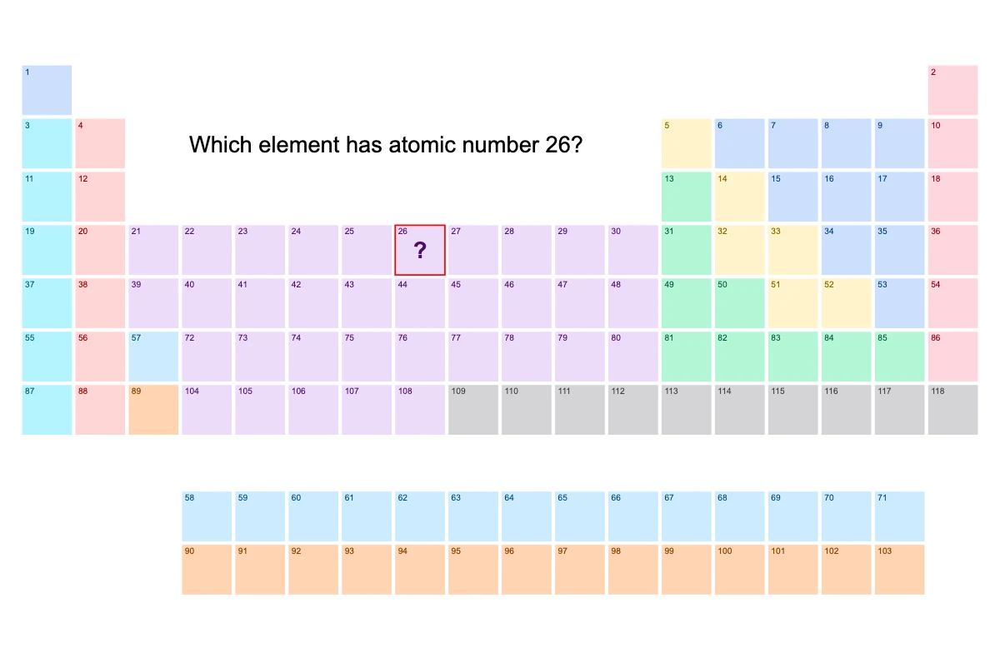</a>
<a class="preview-image preview-back" href="previews/periodic-table-back.webp" aria-label="Enlarge Periodic Table card back">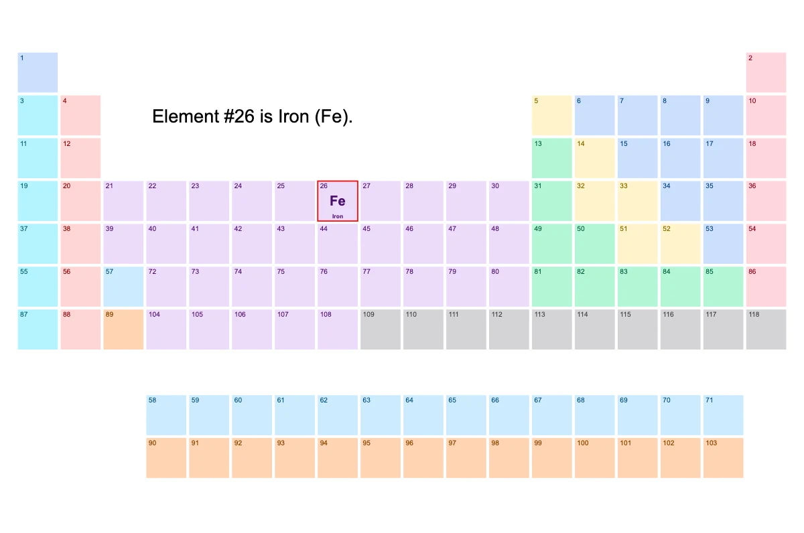</a>

### Periodic Table

This deck contains 708 cards with names, symbols, positions, and properties for all 118 elements.

<a class="deck-download gallery-icon" href="https://github.com/AK1089/anki-decks/raw/refs/heads/main/decks/periodic-table/periodic-table.apkg" aria-label="Download periodic-table.apkg" title="Download .apkg"><svg aria-hidden="true" viewBox="0 0 24 24"><use href="/assets/icons/sprite.svg#download"></use></svg></a>

</article>

<article class="deck-card" markdown="1">

<input type="radio" name="tube-map-side" id="tube-map-front" value="front" checked>
<label for="tube-map-front">Front</label>
<input type="radio" name="tube-map-side" id="tube-map-back" value="back">
<label for="tube-map-back">Back</label>
<a class="preview-image preview-front" href="previews/tube-map-front.webp" aria-label="Enlarge London Tube card front">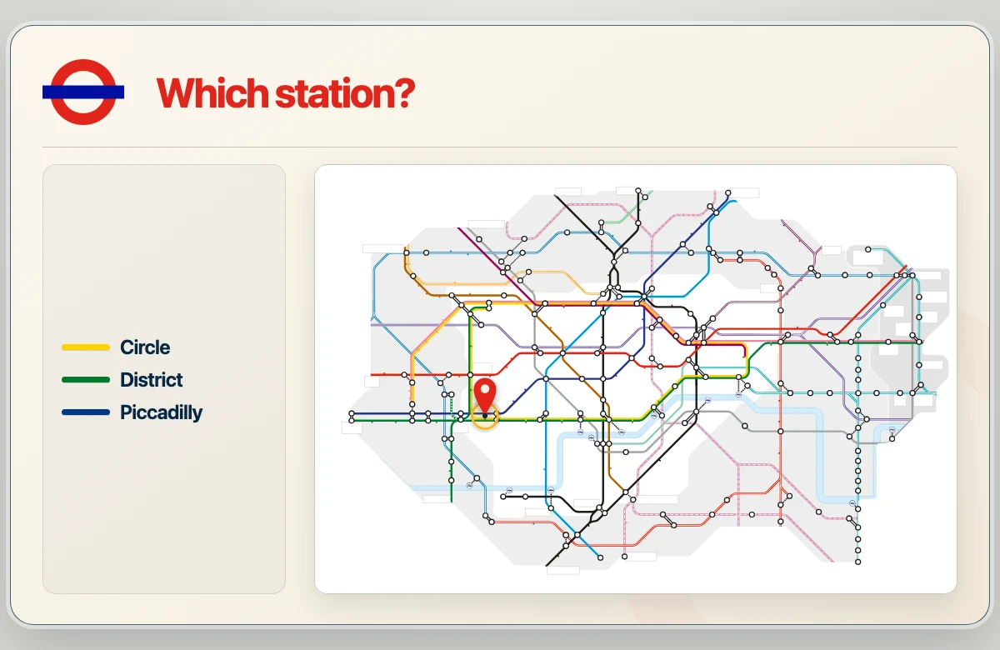</a>
<a class="preview-image preview-back" href="previews/tube-map-back.webp" aria-label="Enlarge London Tube card back">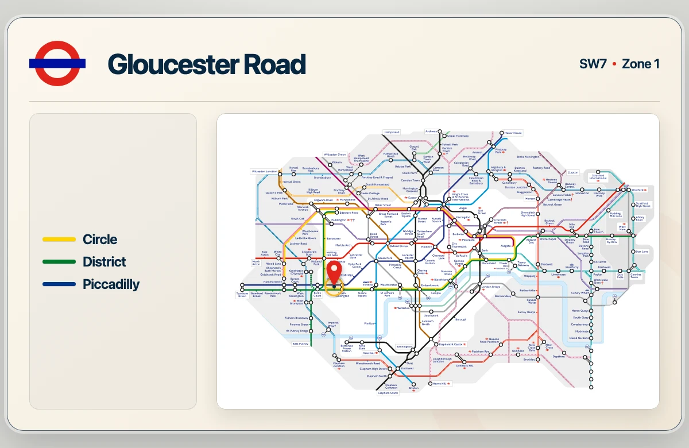</a>

### London Tube

This deck contains 266 cards for the 133 stations in Zones 1 and 2 on a blank map.

<a class="deck-download gallery-icon" href="https://github.com/AK1089/anki-decks/raw/refs/heads/main/decks/tube-map/tube-map.apkg" aria-label="Download tube-map.apkg" title="Download .apkg"><svg aria-hidden="true" viewBox="0 0 24 24"><use href="/assets/icons/sprite.svg#download"></use></svg></a>

</article>

<article class="deck-card" markdown="1">

<input type="radio" name="amsterdam-metro-map-side" id="amsterdam-metro-map-front" value="front" checked>
<label for="amsterdam-metro-map-front">Front</label>
<input type="radio" name="amsterdam-metro-map-side" id="amsterdam-metro-map-back" value="back">
<label for="amsterdam-metro-map-back">Back</label>
<a class="preview-image preview-front" href="previews/amsterdam-metro-map-front.webp" aria-label="Enlarge Amsterdam Metro card front">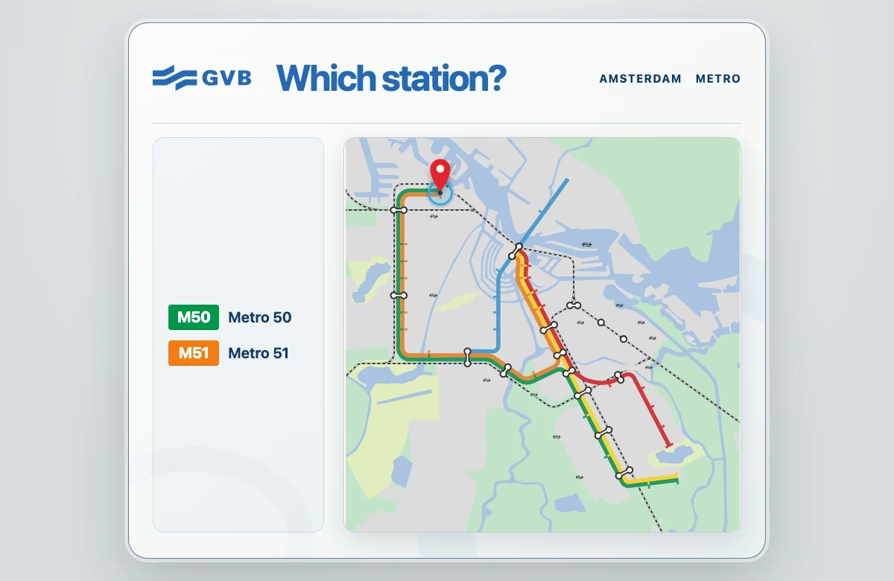</a>
<a class="preview-image preview-back" href="previews/amsterdam-metro-map-back.webp" aria-label="Enlarge Amsterdam Metro card back">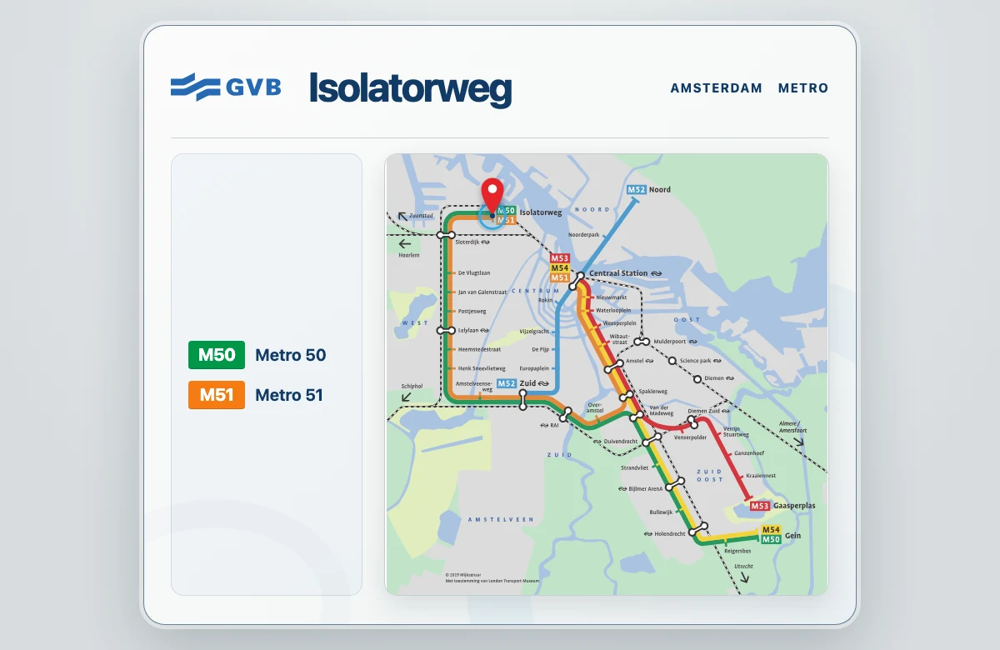</a>

### Amsterdam Metro

This deck contains 78 cards for the 39 stations across the network on a blank map.

<a class="deck-download gallery-icon" href="https://github.com/AK1089/anki-decks/raw/refs/heads/main/decks/amsterdam-metro-map/amsterdam-metro-map.apkg" aria-label="Download amsterdam-metro-map.apkg" title="Download .apkg"><svg aria-hidden="true" viewBox="0 0 24 24"><use href="/assets/icons/sprite.svg#download"></use></svg></a>

</article>

<article class="deck-card" markdown="1">

<input type="radio" name="countries-side" id="countries-front" value="front" checked>
<label for="countries-front">Front</label>
<input type="radio" name="countries-side" id="countries-back" value="back">
<label for="countries-back">Back</label>
<a class="preview-image preview-front" href="previews/countries-front.webp" aria-label="Enlarge Countries card front">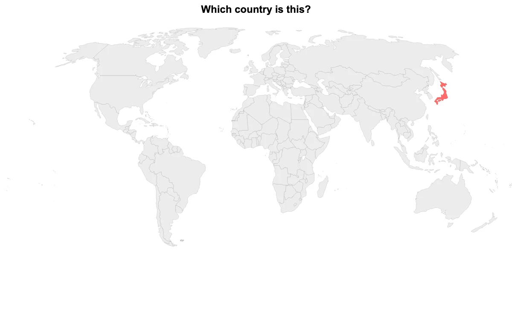</a>
<a class="preview-image preview-back" href="previews/countries-back.webp" aria-label="Enlarge Countries card back">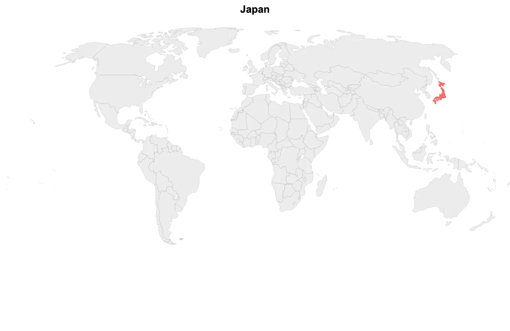</a>

### Countries

This deck contains 744 cards with names, capitals, flags, and map locations for each of 186 countries.

<a class="deck-download gallery-icon" href="https://github.com/AK1089/anki-decks/raw/refs/heads/main/decks/countries/countries.apkg" aria-label="Download countries.apkg" title="Download .apkg"><svg aria-hidden="true" viewBox="0 0 24 24"><use href="/assets/icons/sprite.svg#download"></use></svg></a>

</article>

<article class="deck-card" markdown="1">

<input type="radio" name="ipa-side" id="ipa-front" value="front" checked>
<label for="ipa-front">Front</label>
<input type="radio" name="ipa-side" id="ipa-back" value="back">
<label for="ipa-back">Back</label>
<a class="preview-image preview-front" href="previews/ipa-front.webp" aria-label="Enlarge IPA card front">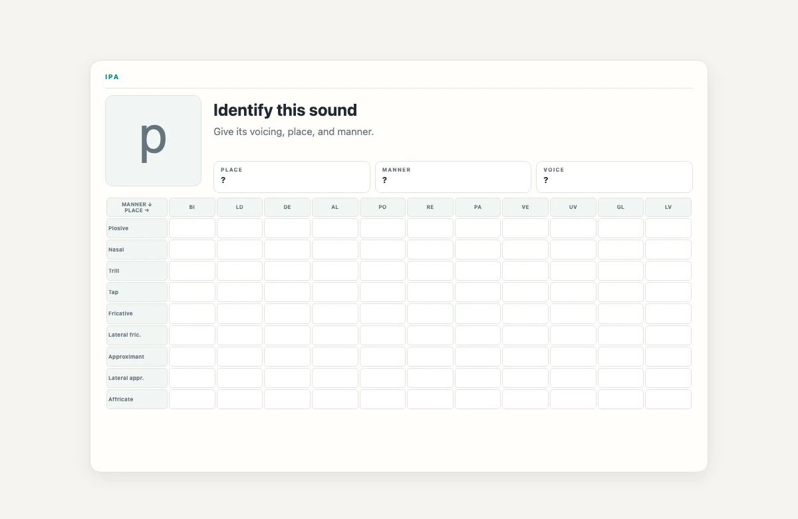</a>
<a class="preview-image preview-back" href="previews/ipa-back.webp" aria-label="Enlarge IPA card back">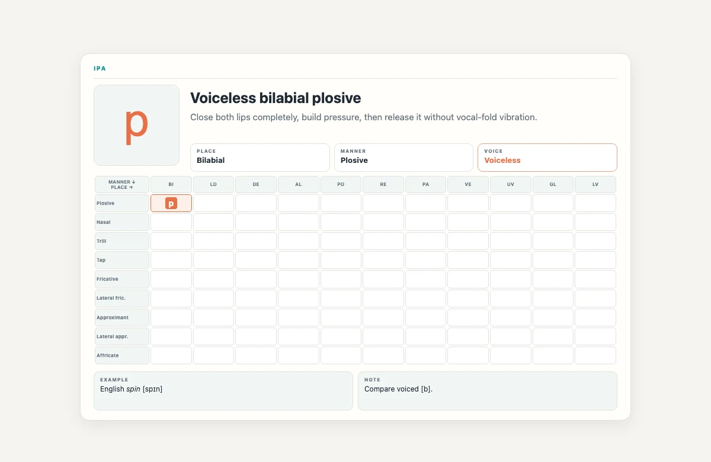</a>

### IPA

This deck contains 120 cards for recognition of phonetic symbols for all 40 IPA consonants and their articulatory descriptions.

<a class="deck-download gallery-icon" href="https://github.com/AK1089/anki-decks/raw/refs/heads/main/decks/ipa/ipa.apkg" aria-label="Download ipa.apkg" title="Download .apkg"><svg aria-hidden="true" viewBox="0 0 24 24"><use href="/assets/icons/sprite.svg#download"></use></svg></a>

</article>

<article class="deck-card" markdown="1">

<input type="radio" name="alphabet-side" id="alphabet-front" value="front" checked>
<label for="alphabet-front">Front</label>
<input type="radio" name="alphabet-side" id="alphabet-back" value="back">
<label for="alphabet-back">Back</label>
<a class="preview-image preview-front" href="previews/alphabet-front.webp" aria-label="Enlarge Alphabet card front">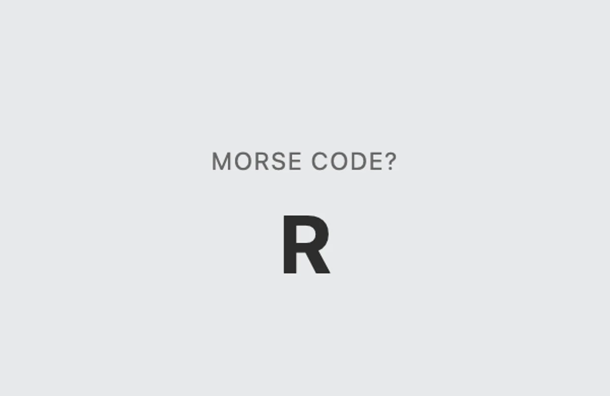</a>
<a class="preview-image preview-back" href="previews/alphabet-back.webp" aria-label="Enlarge Alphabet card back">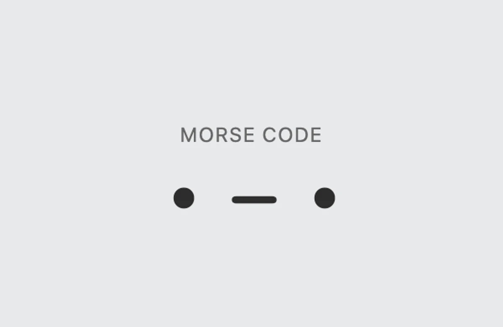</a>

### Alphabet

This deck contains 156 cards describing positions, Morse code, NATO spellings, and letter frequencies for the 26 English letters.

<a class="deck-download gallery-icon" href="https://github.com/AK1089/anki-decks/raw/refs/heads/main/decks/alphabet/alphabet.apkg" aria-label="Download alphabet.apkg" title="Download .apkg"><svg aria-hidden="true" viewBox="0 0 24 24"><use href="/assets/icons/sprite.svg#download"></use></svg></a>

</article>

