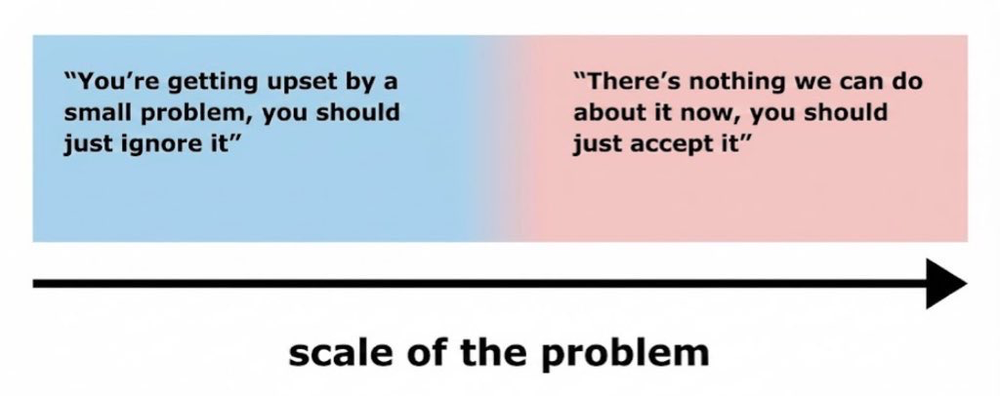

I am a big fan of this image.

It's a response to a kind of trap. Something lies along a spectrum, and there are criticisms of either end of the spectrum which are *individually* reasonable. But they are each deployed so widely that there is no point on the spectrum where you are free from both. A problem is either too small (blue) or too large (red) to do anything about, and so you are dismissed.

Both of these judgments are coherent in isolation. Sometimes a problem really is too small or too large to do something about. But you can't have it both ways! There has to be some size of problem you'd accept a complaint about.

I am going to call this the *pincer dismissal*. You have two critiques of the two ends of the spectrum, and you deploy them as a pincer—the bounds of what is vulnerable to each keep tightening until they overlap, much like the purple area in the image, where either one will do. It's a kind of double bind, or a "heads I win / tails you lose" situation.

Each time, or each particular person, only needs one side of the argument to be deployed. If two people use this tactic, no individual person is being hypocritical (à la the [Goomba fallacy](https://en.wiktionary.org/wiki/Goomba_fallacy), neither is doing anything wrong). But it is nonetheless frustrating and unfair to the person making the original point. Every objection is locally fine, but together they create the pincer.

There are so many examples of this tactic.

- That's just one anecdote, it doesn't prove anything.
  Why do you have so many examples of this? You seem obsessed.
- This doesn't affect you. Stay out of it.
  You're too personally involved in this. You can't be objective.
- That's too soon, stop jumping on this tragedy to further your agenda.
  You're still hung up on that? Who cares.
- You seem fine, you clearly don't care that much.
  You're too emotional for this, you aren't thinking straight.
- It's easy for an outsider to say this.
  Well then if it's so bad, why are you still involved?
- You just have vague complaints, you can't actually point to anything wrong.
  Stop nitpicking, you're being pedantic.
- You aren't open to changing your mind, you're just pushing an agenda.
  You keep flip-flopping, why should we trust you?

The only real remedy is to force your interlocutor to make explicit exactly where on the spectrum they want you to be. Somewhere between the blue and red there ought to be a gap.
